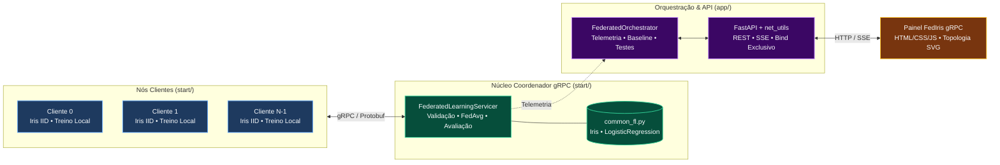
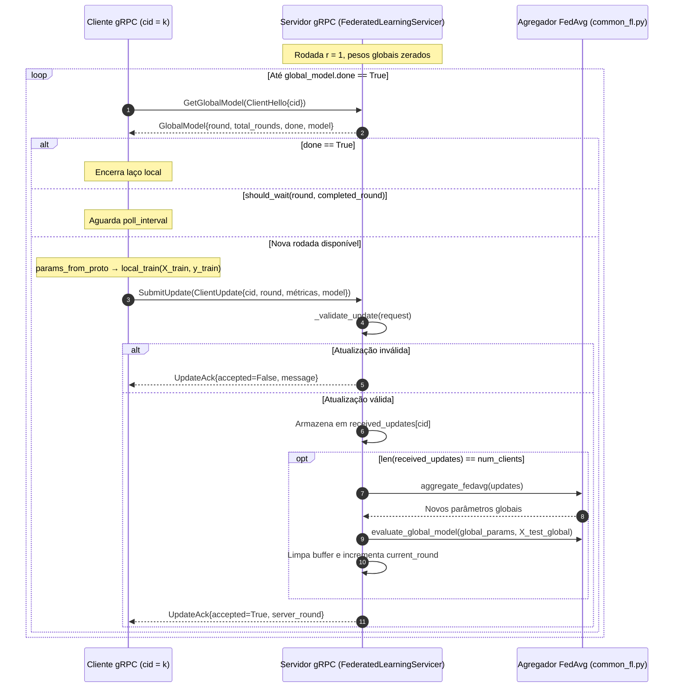
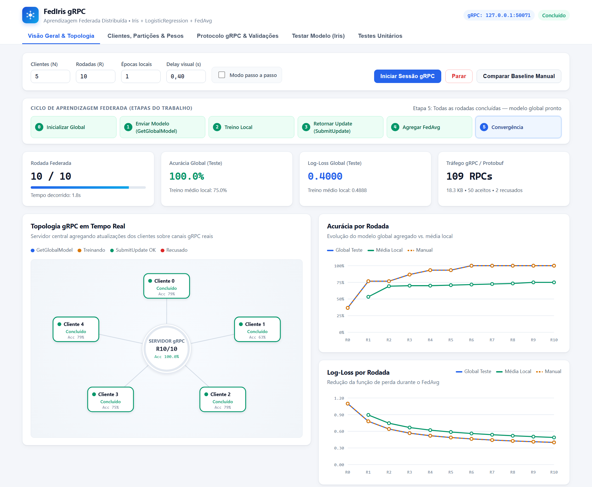
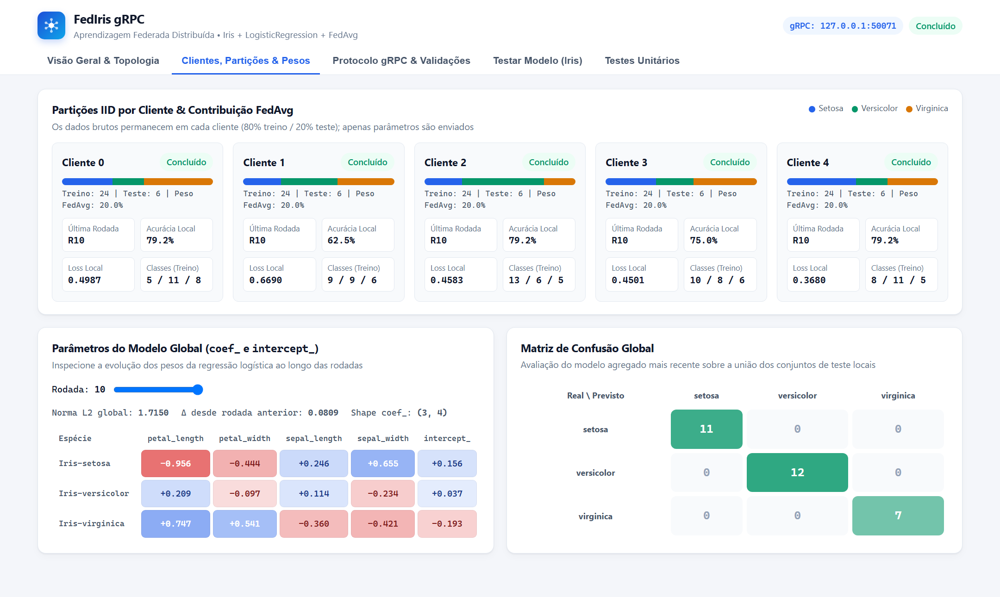
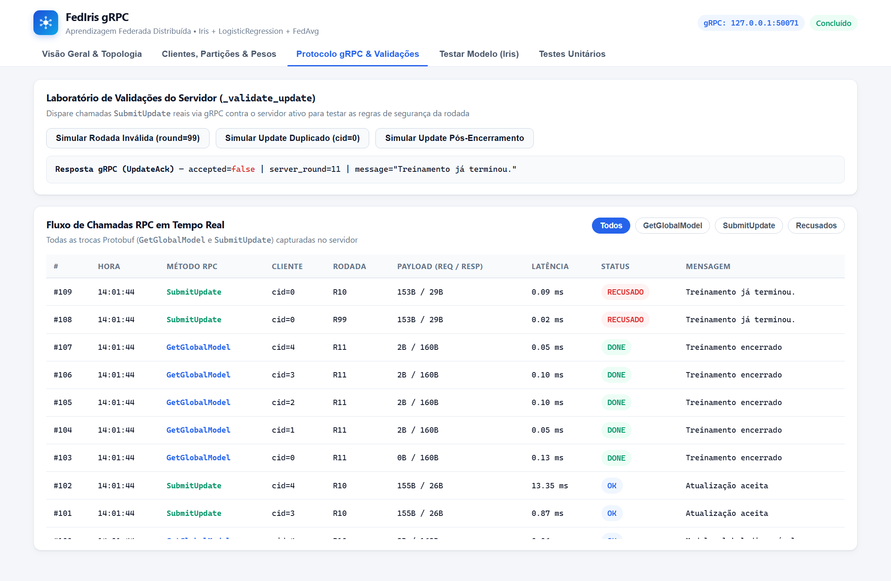
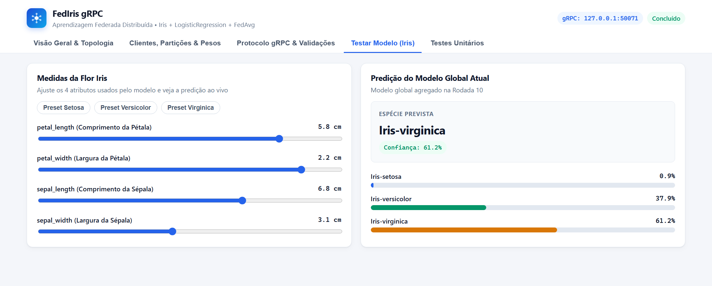
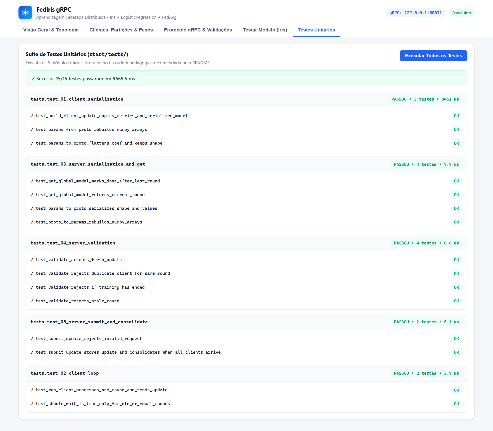

# FedIris gRPC — Aprendizagem Federada Distribuída


Sistema distribuído de **Aprendizagem Federada (*Federated Learning*)** utilizando **gRPC**, **Protocol Buffers** e o algoritmo **FedAvg (*Federated Averaging*)** aplicado à classificação multiclasse do dataset clássico **Iris**, acompanhado de uma **interface web interativa** para visualização em tempo real da topologia distribuída, métricas de convergência, evolução de pesos, validações de protocolo e execução da suíte de testes unitários.

---

## Informações Acadêmicas

| Campo | Detalhes |
| :--- | :--- |
| **Instituição** | Universidade Federal do Ceará (UFC) |
| **Disciplina** | Sistemas Distribuídos — Trabalho 1 |
| **Professor** | Filipe Maciel Roberto |
| **Aluno / Autor** | [Felipi Ribeiro dos Santos](https://github.com/felpsrib) |

---

## Visão Geral

No aprendizado de máquina centralizado tradicional, os dados produzidos por diferentes dispositivos ou organizações precisam ser transferidos para um servidor central antes do treinamento. Em cenários reais — como saúde, finanças ou aplicativos móveis — essa centralização enfrenta barreiras severas de **privacidade**, **regulamentação** (como LGPD e GDPR) e **custo de comunicação**.

A **Aprendizagem Federada** inverte esse paradigma: em vez de mover os dados até o processamento, **move-se o treinamento até os dados**. Os dados brutos nunca saem dos nós clientes; apenas os parâmetros atualizados do modelo trafegam pela rede até o servidor coordenador.

### Ciclo Federado Implementado

1. **Inicialização (Rodada 0):** o servidor cria o modelo global inicial (`LogisticRegression` com pesos zerados) e disponibiliza seus parâmetros.
2. **Distribuição (`GetGlobalModel`):** cada cliente consulta o modelo global atual via gRPC e verifica se há uma nova rodada disponível.
3. **Treinamento Local:** cada cliente treina localmente sobre sua partição IID do dataset **Iris** (80% treino local / 20% teste local) utilizando `warm_start=True` e `max_iter=1`.
4. **Envio de Atualizações (`SubmitUpdate`):** os clientes serializam `coef_` (matriz achatada + `shape`) e `intercept_` em mensagens Protobuf e enviam somente os parâmetros e métricas locais ao servidor.
5. **Validação e Agregação (FedAvg):** o servidor valida cada atualização (rejeitando rodadas inválidas, clientes duplicados ou envios pós-encerramento). Ao receber todos os $K$ clientes esperados, consolida o novo modelo global pela média ponderada pelo número de exemplos de cada cliente:

$$w^{(t+1)} = \sum_{k=1}^{K} \frac{n_k}{n} \, w_k^{(t+1)}, \qquad n = \sum_{k=1}^{K} n_k$$

6. **Repetição e Convergência:** o ciclo se repete até atingir o número total de rodadas configurado, sinalizando `done = True` aos clientes e encerrando a federação.

---

## Arquitetura do Sistema

O sistema foi organizado em camadas desacopladas para manter **100% de compatibilidade** com a estrutura e os testes unitários exigidos na disciplina (`start/`), adicionando observabilidade em tempo real, segurança de portas e painel web interativo (`app/` + `run_ui.py`):



### Fluxo de Comunicação gRPC por Rodada



### Contrato gRPC (`start/federated.proto`)

```protobuf
service FederatedLearning {
  rpc GetGlobalModel (ClientHello) returns (GlobalModel);
  rpc SubmitUpdate (ClientUpdate) returns (UpdateAck);
}
```

- **`ModelParameters`**: transporta `coef_values` (`repeated double`), `coef_shape` (`repeated int32`) e `intercept_values` (`repeated double`), reconstruindo exatamente os arrays NumPy entre cliente e servidor.
- **`GlobalModel`**: informa `round`, `total_rounds`, `done`, `message` e `model`.
- **`ClientUpdate` / `UpdateAck`**: envia `cid`, `round`, `num_examples`, `train_loss`, `train_acc` e os pesos treinados localmente, recebendo confirmação (`accepted`, `message`, `server_round`).

---

## Telas do Sistema (Interface Web `FedIris gRPC`)

A interface web é totalmente autocontida (HTML5, CSS3, JavaScript puro e visualizações em SVG — sem dependências externas de CDN, funcionando inclusive offline) e acompanha execuções reais sobre canais gRPC em **5 telas**:

### 1. Visão Geral & Topologia


Painel principal de controle e monitoramento da federação:
- **Barra de configuração:** permite definir número de clientes ($N$), total de rodadas ($R$), épocas locais, *delay* visual e ativar o **modo passo a passo** (ideal para demonstrações didáticas rodada a rodada), além de disparar a **baseline manual** (`fl_sim_manual.py`) para comparação direta.
- **Ciclo de Aprendizagem Federada (Etapas 0 a 5):** destaca em tempo real em qual fase do protocolo o sistema se encontra.
- **KPIs em tempo real:** exibe a rodada atual, a **Acurácia Global** no conjunto de teste (chegando a **100%**), a **Log-Loss Global** e o volume total de **RPCs e bytes Protobuf** trafegados (incluindo atualizações aceitas e recusadas).
- **Topologia gRPC em SVG + Gráficos de Convergência:** mostra o servidor central cercado pelos $N$ clientes conectados via gRPC (com pacotes animados trafegando nas arestas durante a execução) e gráficos comparativos de **Acurácia** e **Log-Loss** entre o modelo global agregado, a média do treino local e a linha tracejada da baseline manual.

---

### 2. Clientes, Partições & Pesos


Visão interna dos dados distribuídos e dos parâmetros aprendidos pelo modelo global:
- **Partições IID por Cliente:** exibe para cada cliente a proporção local das 3 espécies do dataset Iris (*Setosa*, *Versicolor*, *Virginica*), a divisão 80% treino / 20% teste, o **peso relativo no FedAvg** ($n_k / n$) e as métricas locais da última rodada — evidenciando que os dados brutos permanecem em cada cliente.
- **Heatmap Interativo de Parâmetros (`coef_` e `intercept_`):** permite inspecionar a matriz $3 \times 4$ de pesos e o vetor de interceptos da regressão logística, com um seletor de rodada para acompanhar a evolução desde a Rodada 0 (zerada) até a convergência, exibindo também a norma $L_2$ global e o $\Delta$ entre rodadas.
- **Matriz de Confusão Global:** avalia o modelo agregado mais recente sobre a união dos conjuntos de teste locais dos clientes.

---

### 3. Protocolo gRPC & Validações


Ferramenta de inspeção de rede e validação das regras de segurança implementadas em `_validate_update`:
- **Laboratório de Validações:** botões para disparar chamadas `SubmitUpdate` reais contra o servidor gRPC ativo simulando **rodada inválida (`round=99`)**, **atualização duplicada (`cid=0`)** e **envio pós-encerramento**, exibindo a resposta exata `UpdateAck` (`accepted`, `server_round`, `message`).
- **Fluxo de Chamadas RPC em Tempo Real:** tabela filtrável (`Todos`, `GetGlobalModel`, `SubmitUpdate`, `Recusados`) registrando cada chamada Protobuf com horário, cliente, rodada, tamanho do payload (requisição/resposta em bytes), latência em milissegundos, status (`OK`, `DONE`, `RECUSADO`) e mensagem retornada pelo servidor.

---

### 4. Testar Modelo (Iris)


Laboratório interativo de inferência diretamente sobre o modelo global federado atual:
- **Sliders e Presets:** permite ajustar livremente os 4 atributos numéricos (`petal_length`, `petal_width`, `sepal_length`, `sepal_width`) ou carregar perfis típicos de *Setosa*, *Versicolor* e *Virginica*.
- **Predição ao Vivo:** exibe a espécie prevista, o nível de confiança e a distribuição de probabilidades (`predict_proba`) das 3 classes usando os pesos consolidados da rodada mais recente — possibilitando observar o modelo evoluir de ~33% uniforme na Rodada 0 até classificações confiantes após o treino federado.

---

### 5. Testes Unitários


Integração direta com a suíte oficial de validação do trabalho (`start/tests/`):
- Executa todos os **5 módulos de teste** na ordem pedagógica recomendada pelo roteiro da disciplina (`test_01` → `test_03` → `test_04` → `test_05` → `test_02`).
- Exibe o resumo geral de aprovação (**15/15 testes passando**), a duração por módulo e o status individual de cada caso de teste.

---

## Proteção contra Colisão de Portas

Para evitar que outro serviço na mesma máquina intercepte o painel web ou o servidor gRPC (cenário comum no Windows com `SO_REUSEADDR` ou conflitos IPv4/IPv6):

- **Bind exclusivo sem *race condition* (`app/net_utils.py`):** testa disponibilidade em **IPv4 (`127.0.0.1`) e IPv6 (`::1`)** com `SO_EXCLUSIVEADDRUSE` e entrega o socket já reservado diretamente ao Uvicorn.
- **Verificação de identidade (`/api/health`):** o launcher `run_ui.py` gera um `instance_id` único e **só abre o navegador** após confirmar que `GET /api/health` responde com `app == "fediris-grpc"` e o mesmo `instance_id` — impedindo abrir outro sistema por engano.
- **Modo estrito opcional (`--strict-port`):** permite escolher entre migrar automaticamente para a próxima porta livre ou abortar com erro explícito.
- **Proteção no gRPC (`grpc.so_reuseport=0`):** desativa compartilhamento silencioso de porta e valida `bound_port != 0` tanto no orquestrador quanto no `student_fl_server_grpc.py`, além de diagnosticar `StatusCode.UNIMPLEMENTED` no cliente caso outro servidor gRPC ocupe a porta.

---

## Estrutura de Diretórios

```text
.
├── pyproject.toml                  # Metadados, dependências e configuração Pyright
├── run_ui.py                       # Launcher único da interface web (bind exclusivo + /api/health)
├── fl_sim_manual.py                # Simulação manual em memória (referência didática)
├── README.md                       # Documentação do projeto
├── .gitignore                      # Arquivos ignorados pelo Git
├── docs/
│   └── screenshots/                # Capturas das 5 telas do painel web
├── start/                          # Núcleo oficial do Trabalho 1 (compatível com avaliação)
│   ├── federated.proto             # Definição do serviço e mensagens gRPC/Protobuf
│   ├── federated_pb2.py            # Stubs de mensagens gerados via grpc_tools.protoc
│   ├── federated_pb2.pyi           # Stubs de tipagem estática gerados via --pyi_out
│   ├── federated_pb2_grpc.py       # Stubs de serviço gRPC gerados via grpc_tools.protoc
│   ├── common_fl.py                # Particionamento Iris, LogisticRegression, treino local e FedAvg
│   ├── student_fl_client_grpc.py   # Implementação completa do cliente gRPC
│   ├── student_fl_server_grpc.py   # Implementação completa do servidor gRPC
│   ├── README.md                   # Roteiro original da disciplina
│   └── tests/                      # Suíte de testes unitários progressivos (15 testes)
│       ├── test_01_client_serialization.py
│       ├── test_02_client_loop.py
│       ├── test_03_server_serialization_and_get.py
│       ├── test_04_server_validation.py
│       ├── test_05_server_submit_and_consolidate.py
│       └── utils.py
└── app/                            # Orquestração gRPC observável, rede segura e painel web
    ├── net_utils.py                # Detecção IPv4/IPv6 e bind exclusivo de sockets
    ├── orchestrator.py             # Gerenciador de sessões gRPC, telemetria, inferência e testes
    ├── server.py                   # API FastAPI (REST + SSE + /api/health)
    └── static/                     # Frontend web autocontido
        ├── index.html
        ├── styles.css
        └── app.js
```

---

## Instalação e Configuração

### Pré-requisitos
- Python **3.9 ou superior** (testado em Python 3.13)

### 1. Clonar o repositório e criar o ambiente virtual

**Windows (PowerShell):**
```powershell
git clone git@github.com:felpsrib/aprendizagem-federada-grpc.git
cd aprendizagem-federada-grpc

python -m venv .venv
.\.venv\Scripts\Activate.ps1
pip install flwr-datasets numpy pandas scikit-learn grpcio grpcio-tools fastapi uvicorn
```

**Linux / macOS:**
```bash
git clone git@github.com:felpsrib/aprendizagem-federada-grpc.git
cd aprendizagem-federada-grpc

python3 -m venv .venv
source .venv/bin/activate
pip install flwr-datasets numpy pandas scikit-learn grpcio grpcio-tools fastapi uvicorn
```

### 2. (Opcional) Regerar os stubs Protobuf
Os arquivos `federated_pb2.py`, `federated_pb2.pyi` e `federated_pb2_grpc.py` já estão versionados em `start/`. Caso altere `start/federated.proto`, regere-os executando dentro de `start/`:

```bash
python -m grpc_tools.protoc -I. --python_out=. --pyi_out=. --grpc_python_out=. federated.proto
```

---

## Como Executar

### Opção 1 — Interface Web Interativa (Recomendado)
Na raiz do projeto:
```bash
python run_ui.py
```
O servidor inicia em `http://127.0.0.1:8000` (ou seleciona automaticamente a próxima porta livre exclusiva caso a 8000 esteja ocupada; use `--strict-port` para exigir a porta especificada) e abre o painel no navegador somente após validar `/api/health`.

### Opção 2 — Execução Distribuída via CLI (Múltiplos Terminais)

**Terminal 1 — Servidor gRPC:**
```bash
cd start
python student_fl_server_grpc.py --host 127.0.0.1 --port 50051 --num-clients 3 --rounds 5
```

**Terminais 2, 3 e 4 — Clientes gRPC:**
```bash
python student_fl_client_grpc.py --cid 0 --server-address 127.0.0.1:50051 --num-clients 3
python student_fl_client_grpc.py --cid 1 --server-address 127.0.0.1:50051 --num-clients 3
python student_fl_client_grpc.py --cid 2 --server-address 127.0.0.1:50051 --num-clients 3
```

### Opção 3 — Simulação Manual em Memória (Referência)
```bash
python fl_sim_manual.py
```

---

## Testes Unitários

Para executar a suíte oficial completa de 15 testes unitários:

```bash
cd start
python -m unittest discover -s tests -v
```

| Módulo de Teste | Escopo Verificado | Status |
| :--- | :--- | :---: |
| `test_01_client_serialization.py` | Serialização/desserialização Protobuf ↔ NumPy e montagem de `ClientUpdate` | Passou (3/3) |
| `test_02_client_loop.py` | Política `should_wait` e laço completo de `run_client` com encerramento em `done=True` | Passou (2/2) |
| `test_03_server_serialization_and_get.py` | Serialização no servidor e resposta de `GetGlobalModel` durante e após o treino | Passou (4/4) |
| `test_04_server_validation.py` | Regras de `_validate_update` (rodada válida, encerrada, inválida e duplicata) | Passou (4/4) |
| `test_05_server_submit_and_consolidate.py` | Armazenamento em buffer, consolidação FedAvg apenas ao receber todos os clientes, limpeza e `training_finished` | Passou (2/2) |

---

## Autor

Desenvolvido por **Felipi Ribeiro dos Santos** ([GitHub: @felpsrib](https://github.com/felpsrib)) como parte da avaliação da disciplina de **Sistemas Distribuídos** (UFC), ministrada pelo professor **Filipe Maciel Roberto**.
